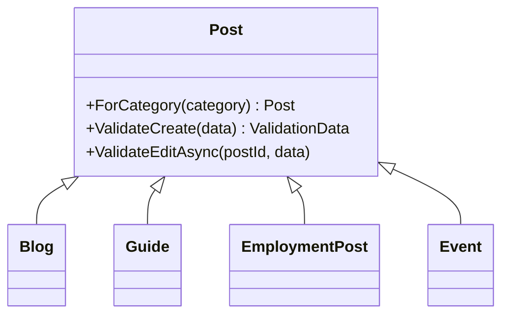

# Publicaciones y moderación en Mujeres Unidas R3.2

**Aporte de Marty (Martin Antonio Valdez Perea)** · Revisión de código y guía de QA para los issues [#12](https://github.com/zorrodev94/MujeresUnidas/issues/12) y [#14](https://github.com/zorrodev94/MujeresUnidas/issues/14).

## Modelo de publicaciones

En Server, `Post` centraliza el ciclo de publicación y delega la persistencia a `PostRepository`. `ForCategory` selecciona el subtipo. Las cuatro clases sobrescriben `ValidateCreate` para validar la subcategoría y el límite de contenido. Al editar, `ValidateEditAsync` consulta la categoría guardada y usa esas mismas reglas.



| Tipo en Server | Categoría en la API | Máximo de caracteres en el contenido |
|---|---|---:|
| `Blog` | `Blog` | 8,000 |
| `Guide` | `Guide` | 12,000 |
| `EmploymentPost` | `Job` | 5,000 |
| `Event` | `Event` | 4,000 |

## Permisos y persistencia

| Actor | Acción |
|---|---|
| Member activo | Envía blogs que quedan pendientes de moderación. |
| Staff activo de Comunidad | Revisa blogs pendientes. Sus propios blogs pueden publicarse al crearlos. Sus guías, empleos y eventos pasan a revisión institucional. |
| Owner o Administrator de Gestión | Revisa guías, empleos y eventos pendientes desde **Publicaciones**. |

La vista **Crear publicación** de Comunidad envía la solicitud a `POST /api/posts`. `PostsController` consulta la sesión con `AccountService` y comprueba los permisos. `PostRepository` guarda los cambios en `dbo.CommunityPosts`. La carga de imágenes se realiza en una solicitud separada. Server acepta PNG o JPEG de hasta 2 MB por imagen, con un máximo de cinco por publicación. `dbo.PostMedia` guarda las referencias a los archivos.

## Pruebas para reunir evidencia

1. **Blog y moderación (#12).** Con un Member activo, crea dos blogs de prueba con títulos que empiecen con `QA-MARTY-`. Selecciona una subcategoría y agrega una imagen ficticia al primero. Comprueba que ambos queden pendientes. Con Staff, abre **Moderación → Leer contenido completo**, aprueba el primero y rechaza el segundo. Comprueba que el primero aparezca con su imagen en **Inicio → Blogs** y que el segundo muestre el rechazo en el perfil del autor.
2. **Permisos institucionales (#14).** Comprueba que Member solo pueda elegir Blog. Con Staff, crea una guía y comprueba que quede pendiente. Con Owner o Administrator, ábrela en **Gestión → Publicaciones** y apruébala. Verifica que aparezca en **Guías**.
3. **Edición de Blog.** Comprueba que el límite de 8,000 caracteres se aplique tanto al crear como al editar.

Consulta de solo lectura para la base de pruebas usada durante la revisión:

```sql
SELECT p.Title, p.Category, p.Status, COUNT(m.Id) AS Imagenes
FROM [MujeresUnidas_R2].dbo.CommunityPosts AS p
LEFT JOIN [MujeresUnidas_R2].dbo.PostMedia AS m ON m.PostId = p.Id
WHERE p.Title LIKE N'QA-MARTY-%'
GROUP BY p.Title, p.Category, p.Status;
```

Los estados esperados son 0 (pendiente), 1 (aprobada) y 2 (rechazada). Anota el resultado observado y adjunta capturas con datos ficticios.

## Estado de la revisión

La herencia, las reglas de edición y los permisos se revisaron en el código fuente de la candidata R3.2. Los casos anteriores quedan pendientes de registrar con evidencia de ejecución en la rama. Este aporte documenta el comportamiento del proyecto.
