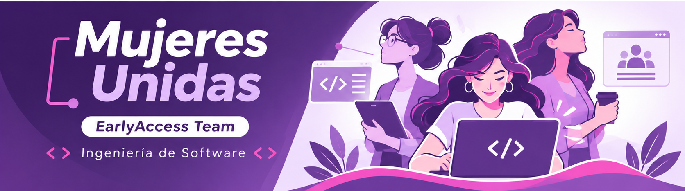
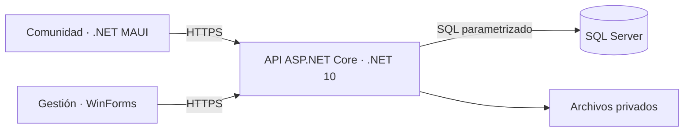

# Mujeres Unidas · EarlyAccess

**Hackathon FIM-UAS 2026 | Versión de entrega 1.0.0 | Ahome, Sinaloa, México**

Mujeres Unidas es un prototipo académico de participación comunitaria y coordinación institucional. Reúne una aplicación de comunidad, un panel de gestión y una API común para organizar actividades, oportunidades, citas y seguimiento de indicadores voluntarios.

## Arquitectura

| Proyecto | Responsabilidad |
| --- | --- |
| `MujeresUnidas.Server` | API, autenticación, reglas, permisos, persistencia y archivos privados |
| `MujeresUnidas.Gestion` | Activaciones, personal, sedes, citas, casos de prueba, metas, reportes y moderación |
| `MujeresUnidas.Comunidad` | Perfiles, publicaciones, momentos, mensajes, búsqueda, atención y encuestas voluntarias |
| `Shared/Contracts` | Contratos compartidos de transporte entre los tres proyectos |

## Alcance de la entrega

- Gestión de cuentas y accesos por aplicación; permisos validados por Server.
- Publicaciones, comentarios, perfiles, distintivos y mensajería según permisos.
- Atención institucional de demostración, sedes y agenda de citas.
- Croquis conceptual de Ahome con sectores y conteos de sedes activas. No muestra calles, GPS ni zonas de peligro.
- Encuestas privadas y voluntarias: estudio, trabajo y contribución percibida. Agregados con supresión de celdas pequeñas; no se atribuye causalidad.
- Reportes operativos a partir de registros persistidos, sin crear resultados ficticios automáticamente.

No se incluye agente de IA. No se incluye cartografía de calles ni atención de emergencia real.

## Instalación y compilación

Requisitos: Windows, Visual Studio 2026, SDK .NET 10, cargas de trabajo de escritorio .NET y MAUI para Windows/Android, SQL Server y SSMS o sqlcmd.

Consulta [instruccion.md](instruccion.md) para compilación, migraciones no destructivas, despliegue y configuración de clientes. Las URLs públicas se suministran al publicar; las credenciales, claves y tokens de infraestructura nunca forman parte del repositorio.

## Seguridad y estado

El prototipo utiliza HTTPS entre clientes y API, autorización en servidor y cifrado de mensajes en reposo (no extremo a extremo). Se requiere validar los flujos de acceso, privacidad y permisos antes de cualquier uso real. Utilizar únicamente datos de demostración. No representa un servicio oficial, ni una herramienta de atención clínica, jurídica o de emergencias.

**Estado de esta revisión:** código de entrega preparado mediante revisión estática; compilación Windows/Android, despliegue 1.0.0 y pruebas integrales pendientes de ejecución en el equipo. No se afirma certificación de producción.

## Equipo y licencia

EarlyAccess · 2do Hackathon FIM-UAS 2026. Consulta [LICENSE.md](LICENSE.md).
